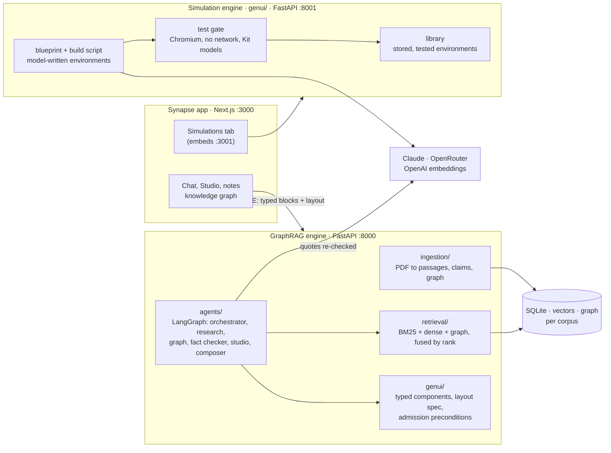
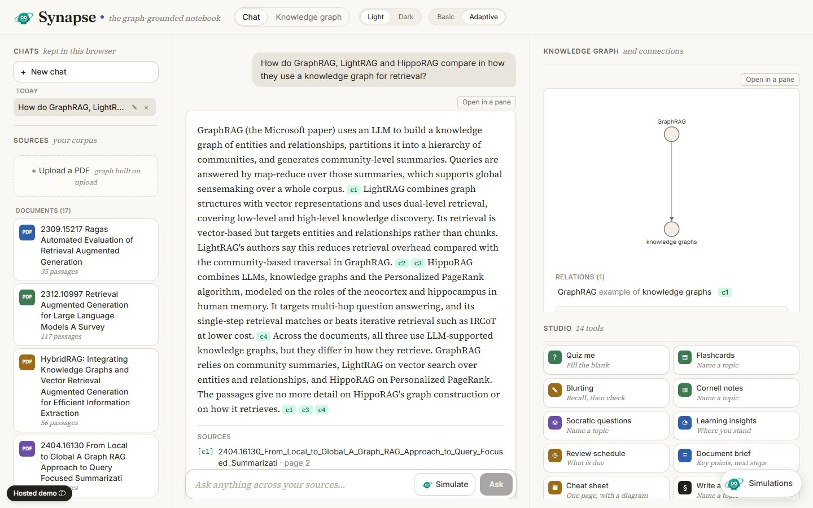
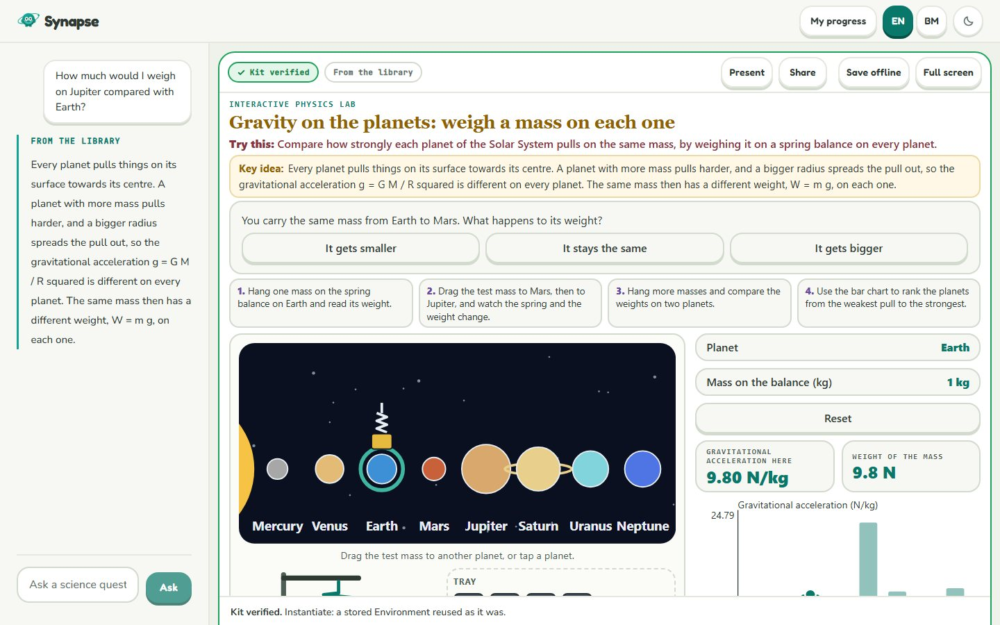
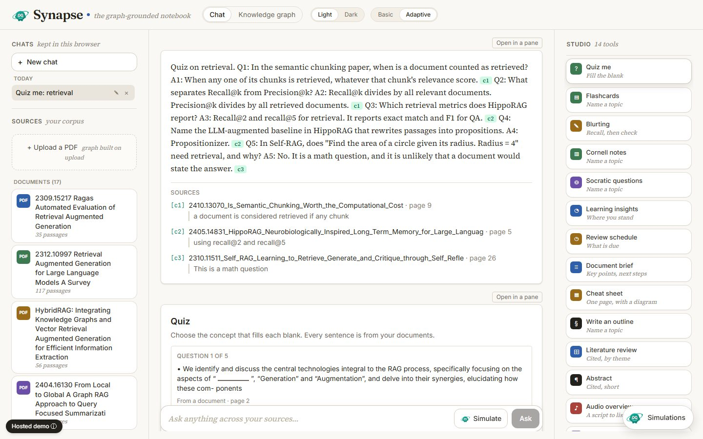
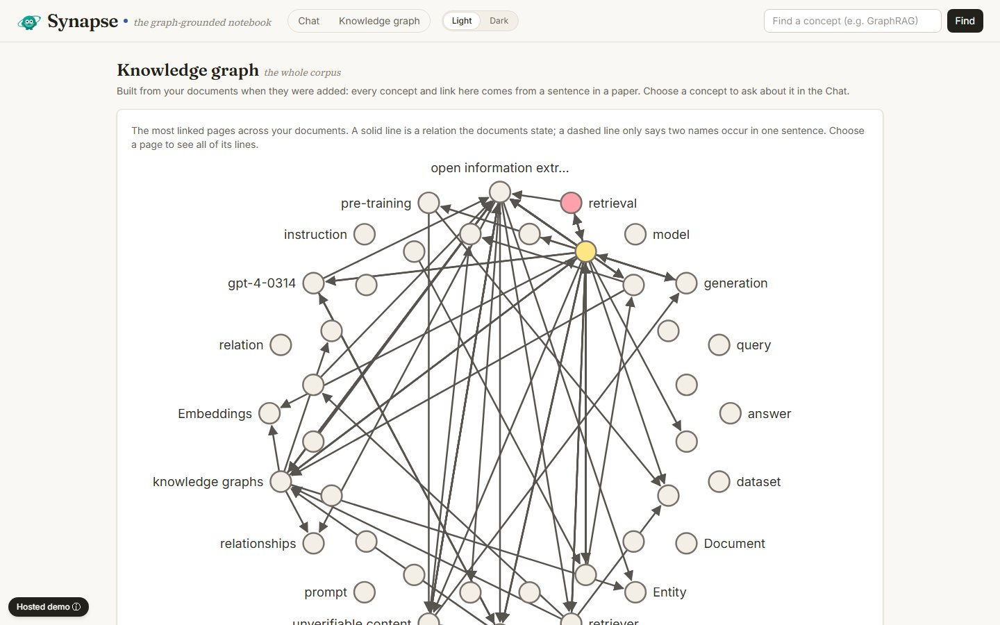
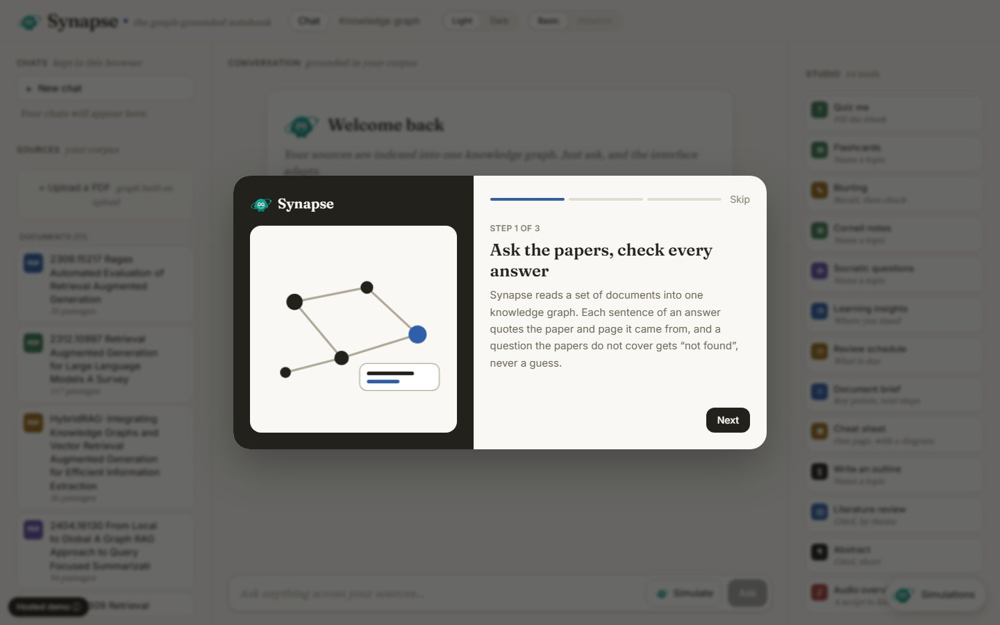

<div align="center">


# Synapse

**Ask your papers. See the idea move.**<br>
A GraphRAG-powered generative UI platform for interactive learning: cited answers from your own documents, study tools
built from them, and hands-on simulations tested in a real browser before you can touch them.

<p>
  <a href="https://synapse-fyp2-demo.vercel.app"></a>
  
  
  
</p>

<sub>built with</sub>

<p>
  
  
  
  
  
  
</p>

<p>
  
  
  
  
  
  
  
</p>

<p>
  
  
  
  
  
  
  
</p>

<sub>Final Year Project 2 · Bachelor of Computer Science (Hons) · Universiti Teknologi PETRONAS · MCAIT 2026 paper · Most Popular Team Award, hackAstone 2026 Grand Final</sub>

</div>

---

Synapse turns a student's own documents into a workspace that answers back. Papers and notes are read into one knowledge
graph beside a vector index. A question gets an answer in which every sentence quotes the paper and page it came from, and the
interface arranges itself around the evidence: a comparison grid, a concept map or a search path appears only when the
retrieved passages support it. The Studio turns the same documents into quizzes, flashcards, notes and cited drafts. For a
science question, **Simulate** builds an interactive environment you drag and drop, checked in a real browser before it is
shown.

**Try it: [synapse-fyp2-demo.vercel.app](https://synapse-fyp2-demo.vercel.app)** (the simulations on their own:
[synapse-fyp2-simulations.vercel.app](https://synapse-fyp2-simulations.vercel.app)). The hosted demo is the real interface
replaying answers recorded from the real system on its 16 research papers. No model runs there, so it answers the recorded
questions, every Studio tool and the stored simulations, not new ones. A first visit gets a short welcome and a guided tour.
How it works: [`demo/README.md`](demo/README.md).

This repository is the FYP2 submission. It continues [Arcana v2](https://github.com/Azimlearning/Arcana-v2) (kept as it was
before Synapse; its full history is in this repository's git log) with the simulation engine in [`genui/`](genui/) and a new
interface. The paper, talks, viva slides and achievements are in the
[FYP showcase repository](https://github.com/Azimlearning/Arcana-Final-Year-Project-UTP).

## What it does

| | |
|---|---|
| **Cited answers** | Every sentence carries a citation that is a word-for-word quote with its paper and page. A question the documents do not cover gets *"No evidence found in your documents"*, never an answer from general knowledge. |
| **Agents** | Orchestrator, Research, Graph and Fact Checker agents with typed tools, calling each other only through `route_to_agent` within hop and token budgets. The interface shows which ran, with tokens and time. |
| **Adaptive interface** | The server chooses the layout and admits a component (comparison grid, concept map, search path, draft, study set) only when the evidence meets that component's written precondition. |
| **Studio, 14 tools** | Quiz, flashcards, blurting, Cornell notes, Socratic questions, document brief, cheat sheet, outline, literature review, abstract, audio-overview script, review schedule and learning insights. Quiz answers are checked by the server. |
| **Knowledge graph** | The concept graph of the corpus, with a page per concept: its passages, cited definitions and links, and a button to ask about it in chat. |
| **Simulations** | A question becomes a drag-and-drop environment with its trust label and what was checked. A stored library answers a repeated question in about 0.15 s; a new one is written by a model and passed or refused by the test gate. |
| **Test gate** | Generated simulations are checked in a browser with no network: page structure and security policy, forbidden code, every control moved across its range, and the numbers compared with an audited science model. |

## Architecture



The browser renders only typed components the server has validated; a component is admitted only when its precondition on the
evidence holds. A simulation reaches the screen only through the gate, and the browser re-hashes its HTML before showing it.
Design and decisions: [`refdocs/arcana-v2-PRD.md`](refdocs/arcana-v2-PRD.md), [`refdocs/changelog/DECISIONS.md`](refdocs/changelog/DECISIONS.md)
and [`genui/refdocs/v5-design/README.md`](genui/refdocs/v5-design/README.md).

## Measured results

Every figure comes from a run recorded in [`refdocs/evidence/`](refdocs/evidence/README.md) or
[`genui/refdocs/evidence/`](genui/refdocs/evidence/), with its limits stated there.

| What | Result |
|---|---|
| Retrieval: hybrid with the graph signal against dense alone, 38 questions on 16 papers | **Not shown to be better**: better on 9, the same on 14, worse on 15; no pair of methods significantly different |
| Grounding with a real model, 38 answerable questions and a control | Every quote verbatim; the unanswerable control refused |
| Trained re-ranker against rank fusion | Built, measured, **not shown to help**, so dropped |
| Test gate against planted faults | Refused 219 of 224 planted faults, no false alarm on 30 correct simulations, all 20 hostile inputs blocked |
| Library simulations | 31 pass 59 of 59 browser checks |
| New questions in live mode | 13 of 14 got a simulation, at about 5.7 US cents each |

## Honest limits

The graph did not improve ranking on this corpus; its value is the structure the adaptive interface needs, not better
retrieval. The 224 planted faults were written by the author, so 219 of 224 is a baseline for catching regressions, not an
unbiased detection rate. No teacher has reviewed the simulations and no learner study has been run, so nothing here shows that
students learn more. Brand-new simulations are slow (minutes, not seconds), which is why the library answers repeated
questions. Both APIs have no authentication and in-process limits only: do not expose them publicly. The hosted demo replays
recorded runs for this reason.

## Run it locally

Requirements: Node 20+ and pnpm 9 for the app; Python 3.13 with [uv](https://docs.astral.sh/uv); the simulation engine in
`genui/` uses Node 24, pnpm 10 and Chromium (`uv run playwright install chromium`). No Docker and no database server: stores are
SQLite. With no API keys everything runs on deterministic fakes at no cost (`ARCANA_LLM_MODE=fake`, the default).

```bash
cp .env.example .env          # values only for live mode; never commit .env
uv sync && pnpm install       # the GraphRAG engine and the app
cd genui && uv sync && pnpm install && pnpm --filter @synapse/kit build && cd ..
```

Start all four servers on Windows, each in its own window, then open <http://localhost:3000>:

```powershell
powershell -ExecutionPolicy Bypass -File .\start-synapse.ps1
powershell -ExecutionPolicy Bypass -File .\stop-synapse.ps1
```

Or the GraphRAG engine alone: `uv run uvicorn api.main:app --reload` and `pnpm --filter web dev`. A live run needs
`LLM_MONTHLY_CAP_USD` set (every paid call is booked and refused before sending if it would pass the cap) and the keys in
[`refdocs/guides/env_setup.md`](refdocs/guides/env_setup.md). A hand-test script with prompts and expected visuals for every
tool is in [`refdocs/guides/manual-testing.md`](refdocs/guides/manual-testing.md).

## Tests

| What | Command |
|---|---|
| GraphRAG backend | `uv run pytest -q` |
| App (Vitest, 474 tests) and types | `cd web && pnpm test && pnpm exec tsc --noEmit` |
| Simulation engine backend | `cd genui && uv run pytest -q` |
| Simulation engine app and Kit | `cd genui && pnpm -r test` |
| Retrieval benchmark (paid in live mode) | `uv run python eval/run_ablation.py` |

## Repository layout

```text
api/              GraphRAG backend: core, llm, stores, ingestion, retrieval, agents, genui, engines, labs
web/              the Synapse app: shell, Studio, notes, graph, Simulations tab, onboarding, demo replay route
packages/schema/  wire types, the single source of truth, generated into Python
eval/             questions, corpus manifest, gold set, ablation runner, audit, mutation suite
refdocs/          PRD, status, decisions, plans, evidence, guides
genui/            the simulation engine: its own api/, web/, Kit of tested components, eval/ and refdocs/
demo/             recorders and notes for the hosted demo
docs/readme/      the logo and pictures in this README
start-synapse.ps1 starts the four servers; stop-synapse.ps1 stops them
```

## Documentation

| Doc | What is in it |
|---|---|
| [`refdocs/STATUS.md`](refdocs/STATUS.md) | Where the GraphRAG engine's build is, phase by phase |
| [`genui/refdocs/STATUS.md`](genui/refdocs/STATUS.md) | Where the simulation engine's build is |
| [`refdocs/evidence/README.md`](refdocs/evidence/README.md) | Every measurement, with its limits |
| [`refdocs/changelog/CHANGELOG.md`](refdocs/changelog/CHANGELOG.md) | Session-by-session history |
| [`demo/README.md`](demo/README.md) | The hosted demo: what is replayed, why, and how to re-record it |
| [`CLAUDE.md`](CLAUDE.md) | Operating brief for AI sessions on this repository |

## Lineage

| Repository | What it is |
|---|---|
| [VERA-AI](https://github.com/Azimlearning/VERA-AI) | The hybrid RAG assistant built during industrial training, where the limits of flat retrieval first showed |
| [Arcana](https://github.com/Azimlearning/Arcana) | v1, frozen at tag `v1.0`: the system the MCAIT 2026 paper describes |
| [Arcana-v2](https://github.com/Azimlearning/Arcana-v2) | The GraphRAG rebuild, as it was before Synapse |
| [Synapse-v4](https://github.com/Azimlearning/Synapse-v4) · [synapse-hackastone](https://github.com/Azimlearning/synapse-hackastone) | Earlier versions of the simulation engine, used at hackAstone 2026 and UTP CodeFest '26 |
| [Arcana-Final-Year-Project-UTP](https://github.com/Azimlearning/Arcana-Final-Year-Project-UTP) | FYP showcase: paper, talks, viva slides and [achievements](https://github.com/Azimlearning/Arcana-Final-Year-Project-UTP/blob/main/ACHIEVEMENTS.md) |

## Publication

F. A. B. Ahmed Mardzukie, "Graph-Grounded Generative User Interfaces for Learning: Retrieval Structure Determines Interface
Expressiveness," in *Proc. 6th International Multi-Conference on Artificial Intelligence Technology (MCAIT 2026)*, Madinah,
Saudi Arabia, Nov. 2026. Accepted and presented on 5 November 2026. The paper describes Arcana v1; findings marked "after the
paper" come from the evidence in this repository and were not peer reviewed.

## Screens

<table>
  <tr>
    <td width="50%"><br><sub><b>Cited answer, Adaptive layout.</b> Every sentence quotes its source; the graph panel appears because the evidence supports it.</sub></td>
    <td width="50%"><br><sub><b>A tested simulation.</b> Drag the mass between planets; the readouts come from an audited science model.</sub></td>
  </tr>
  <tr>
    <td width="50%"><br><sub><b>Studio quiz.</b> Fill-the-blank questions from sentences in the papers; the server checks each answer.</sub></td>
    <td width="50%"><br><sub><b>Knowledge graph.</b> The most linked concepts across the corpus; open one to see every passage behind it.</sub></td>
  </tr>
  <tr>
    <td width="50%"><br><sub><b>First visit.</b> Three welcome slides and a spotlight tour of the real controls, replayable from the demo badge.</sub></td>
    <td width="50%" valign="top"><br><sub>All screenshots are of the hosted demo at <a href="https://synapse-fyp2-demo.vercel.app">synapse-fyp2-demo.vercel.app</a>, captured headlessly at 1440 × 900.</sub></td>
  </tr>
</table>

## Author

<table>
  <tr>
    <td align="center" width="220"><br><b>Fakhrul Azim Bin Ahmed Mardzukie</b><br><sub>Bachelor of Computer Science (Hons), UTP</sub></td>
    <td>
      <b>Supervisor:</b> Dr Mazeyanti Bt M Ariffin<br>
      <b>Co-supervisor:</b> AP Dr Noreen Izza Bt Arshad<br><br>
      Synapse was also presented with Team EduNova at the hackAstone 2026 Grand Final and with Team Dang Wangi at UTP CodeFest '26
      and the Codex Community Hackathon KL; team results belong to the teams. See
      <a href="https://github.com/Azimlearning/Arcana-Final-Year-Project-UTP/blob/main/ACHIEVEMENTS.md">ACHIEVEMENTS.md</a>.
    </td>
  </tr>
</table>

## Licence

No open-source licence has been chosen yet, so all rights are reserved: © 2026 Fakhrul Azim Bin Ahmed Mardzukie. The MCAIT 2026
paper is © 2026 IEEE.
